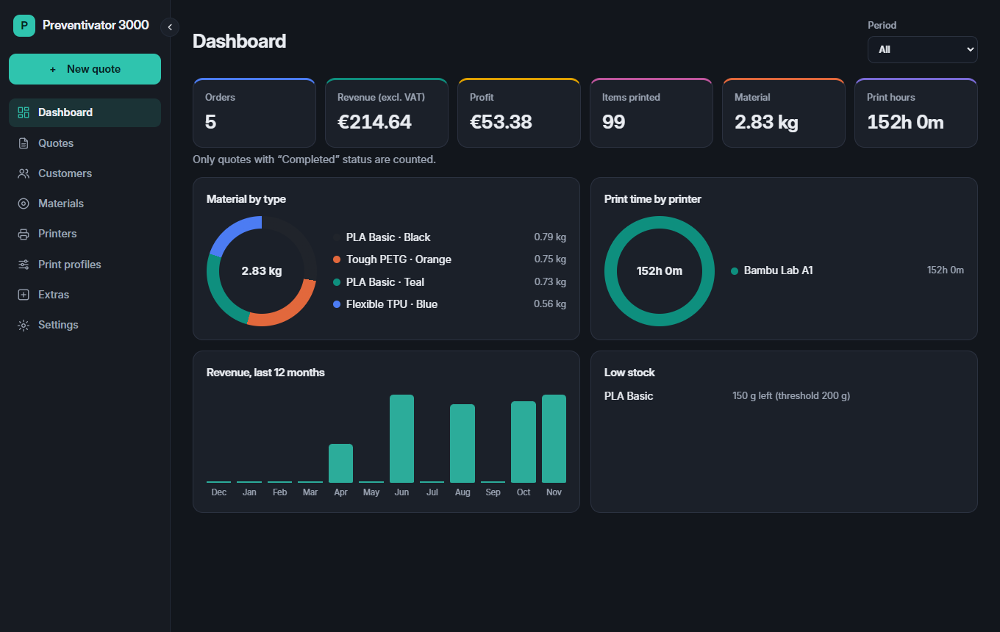
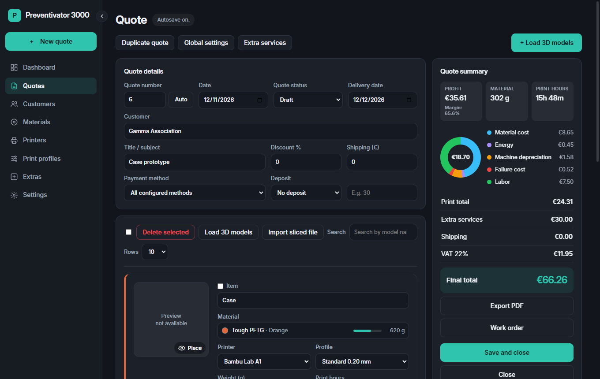
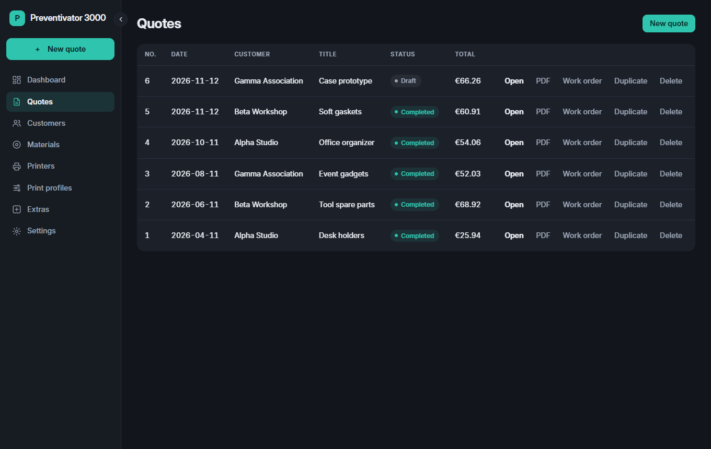
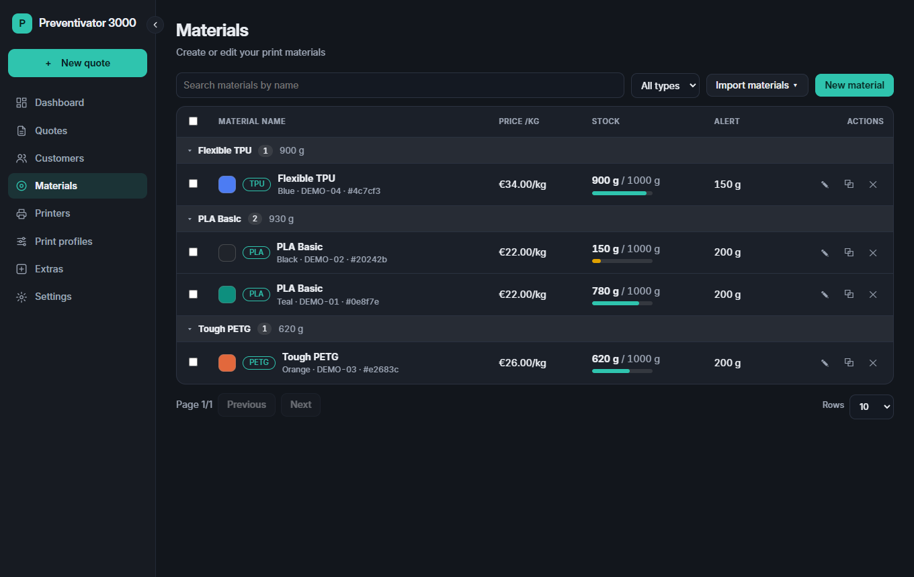
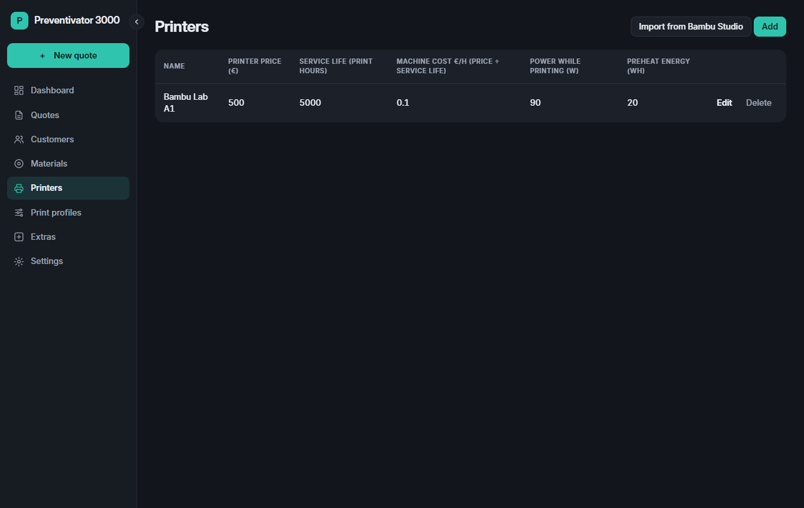

# Preventivator 3000

[Italiano](README.md) | **English**

**3D printing quotes, from the file to the PDF.** Load your models, get weight and print time from Bambu Studio, and arrive at a price based on real costs: material, energy, printer depreciation, waste and labor.

*All screenshots use sample data.*

## What it does

- **Complete quotes:** customers, discounts, shipping, deposits, VAT and extra services.
- **Slicing with Bambu Studio:** process 3MF, STL and STEP files without opening the slicer window, including several files at once.
- **Real costs:** the printer's hourly cost is calculated from its price and service life.
- **3D preview:** place and rotate the model on the Bambu Lab A1 plate.
- **Material stock:** remaining amount for each spool and low-stock alerts.
- **Import from Bambu Studio:** printers, materials and print profiles.
- **PDF:** a quote for the customer and a work order for production.
- **Dashboard:** orders, revenue, profit, material and print hours.
- **Italian and English:** choose the language of the app and of the PDFs.
- **Autosave and updates:** automatic saving once a customer is selected, and update checks at startup.

## The quote

Every change immediately updates the summary: costs, profit and final total.

## All your quotes

Status, total and quick actions to open, duplicate or export to PDF.

## Materials and printers

## Installation

**Windows:** download `Preventivator3000-Setup` from the [latest release](../../releases/latest) and open it. If Windows shows "Windows protected your PC", choose **More info** → **Run anyway**: the installer does not have a digital signature yet.

To slice from the app, [Bambu Studio](https://bambulab.com/en/download/studio) must be installed on the same computer.

## License

Copyright (c) 2026 Nicolò Casella. All rights reserved. See the [LICENSE](LICENSE) file (in Italian).

Bambu Lab and Bambu Studio are trademarks of their respective owners. Preventivator 3000 is an independent project.
