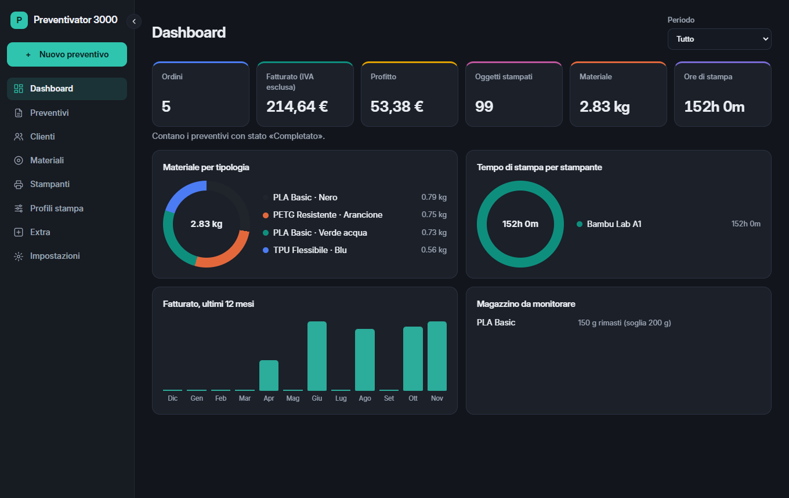
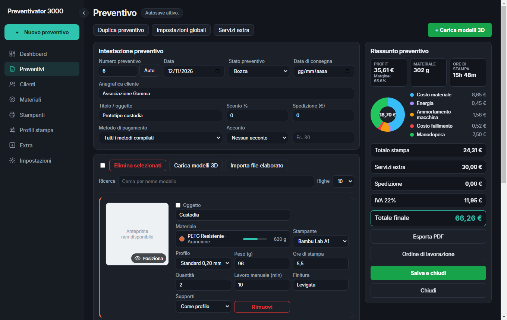
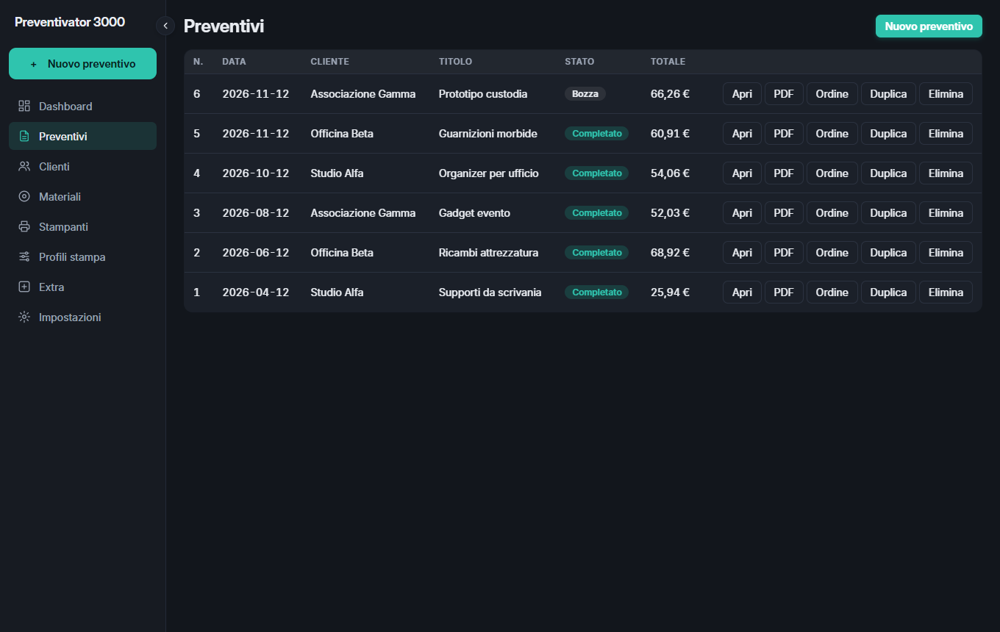
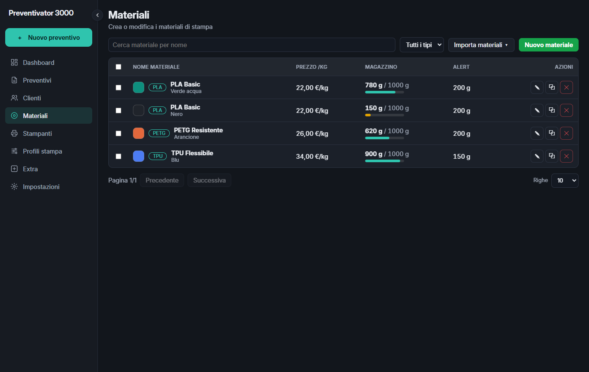
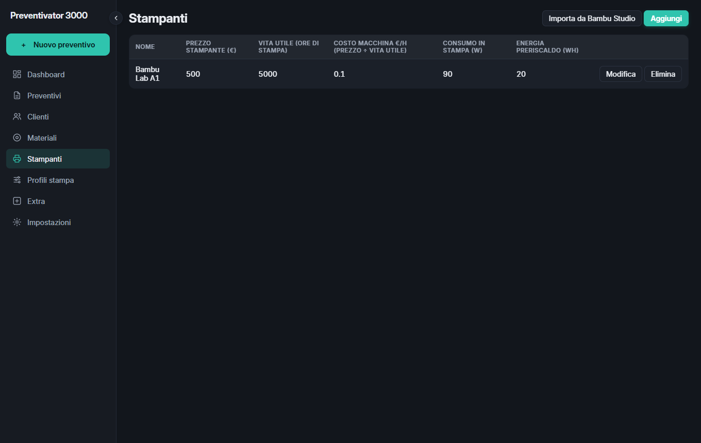
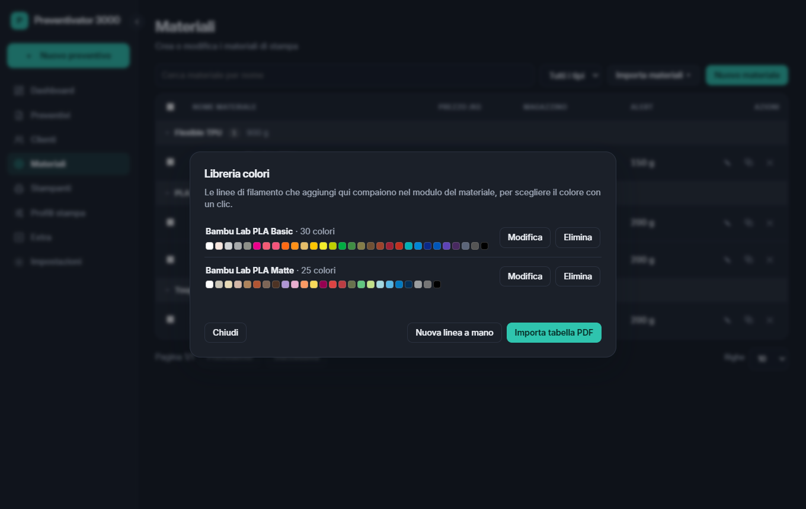
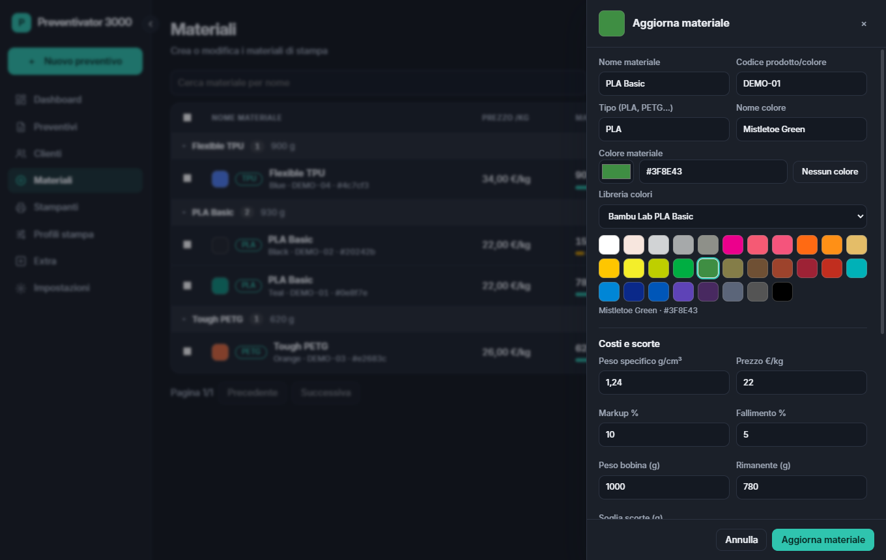

# Preventivator 3000

**Italiano** | [English](README.en.md)

**Preventivi per stampa 3D, dal file al PDF.** Carica i tuoi modelli, ricava peso e tempi con Bambu Studio e ottieni un prezzo basato sui costi reali: materiale, energia, ammortamento della stampante, scarti e manodopera.

*Tutti gli screenshot usano dati dimostrativi.*

## Cosa fa

- **Preventivi completi:** clienti, sconti, spedizione, acconto, IVA e servizi extra.
- **Slicing con Bambu Studio:** elabora file 3MF, STL e STEP senza aprire la finestra dello slicer, anche più file insieme.
- **Costi reali:** il costo orario della stampante si calcola da prezzo e vita utile.
- **Anteprima 3D:** posiziona e ruota il modello sul piatto della Bambu Lab A1.
- **Magazzino materiali:** quantità rimaste per bobina e avvisi sotto soglia.
- **Import da Bambu Studio:** stampanti, materiali e profili di stampa.
- **Libreria colori:** importa le tabelle colori in PDF e scegli il colore del materiale con un clic.
- **PDF:** preventivo per il cliente e ordine di lavorazione.
- **Dashboard:** ordini, fatturato, profitto, materiale e ore di stampa.
- **Italiano e inglese:** lingua del programma e dei PDF a scelta.
- **Autosave e aggiornamenti:** salvataggio automatico quando il cliente è selezionato e aggiornamenti all'avvio.

## Il preventivo

Ogni modifica aggiorna subito il riassunto: costi, profitto e totale finale.

## Tutti i preventivi

Stato, totale e azioni rapide per aprire, duplicare o esportare in PDF.

## Materiali e stampanti

## Libreria colori

Importa una tabella colori in PDF, controlla l'anteprima e aggiungila alla libreria. Nel modulo del materiale scegli la linea e clicchi il colore: nome e codice si compilano da soli. Se un PDF non si legge, puoi inserire i colori a mano.

## Installazione

**Windows:** scarica `Preventivator3000-Setup` dalle [Release](../../releases/latest) e aprilo. Se Windows mostra "PC protetto da Windows", scegli **Ulteriori informazioni** → **Esegui comunque**: l'installer non ha ancora una firma digitale.

Per lo slicing serve [Bambu Studio](https://bambulab.com/it/download/studio) installato sullo stesso computer.

## Licenza

Copyright (c) 2026 Nicolò Casella. Tutti i diritti riservati. Vedi il file [LICENSE](LICENSE).

Bambu Lab e Bambu Studio sono marchi dei rispettivi proprietari. Preventivator 3000 è un progetto indipendente.
